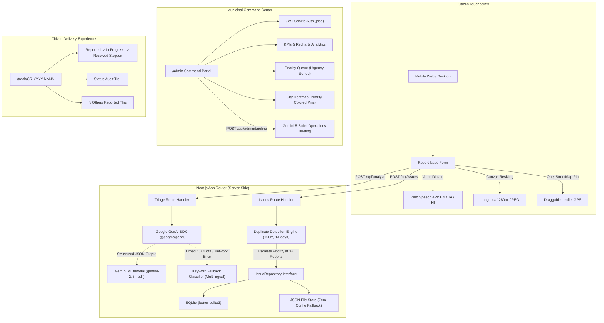

# CivicResolve — AI-Powered Civic Grievance Triage

CivicResolve is an AI-powered municipal issue reporting and grievance lifecycle management platform tailored for the Indian municipal setting (configured for **Coimbatore Municipal Corporation**, map center 11.0147° N, 76.9557° E).

Citizens report potholes, overflowing bins, damaged streetlights, and leaking water mains in **English, Tamil, Hindi, or mixed dialects**. Google Gemini acts as the **triage nurse**—instantaneously categorizing complaints, assessing safety risks, computing urgency scores (0–100), predicting SLA resolution windows, and routing to the appropriate department—while municipal officers remain in control.

---

## Architecture Overview



---

## Key Features

1. **Gemini Multimodal Triage Nurse:**
   - Single server-side API call inspects photographic evidence and citizen narrative.
   - Extracts category, sub-issue, urgency score (0–100), impact factors (safety risk, people affected, sensitive sites), priority justification, department, and field crew instructions.
   - **Auto-fill from photo:** Citizen can simply snap a picture with zero text; Gemini drafts the title, description, and classification.
   - **Unbreakable Resiliency:** If Gemini API key is unset, rate-limited, or safety-blocked, an integrated deterministic keyword classifier kicks in instantly. The app never blocks.

2. **Delivery-Style Tracking (`/track/[code]`):**
   - Citizens track their grievance like a food or courier delivery: `Reported -> In Progress -> Resolved`.
   - Complete audit trail with timestamps, supervisor notes, and resolution verification.

3. **Community Signal & Duplicate Clustering:**
   - Detects existing complaints within a 100-meter radius in the last 14 days.
   - Merges duplicates, increments parent complaint weight, and auto-escalates priority at 3+ reports.

4. **Municipal Command Center (`/admin`):**
   - KPI metrics: Total complaints, active backlog, critical emergencies, resolution rate, average turnaround time, and AI agreement rate.
   - Recharts visual graphs: Department workload, category distribution, resolution funnel, and 7-day complaint trends.
   - Priority queue with rich filters (status, priority, department, fulltext search).
   - One-click **AI Executive Briefing** summarizing backlog bottlenecks into 5 actionable bullet points.
   - Interactive city-wide incident heatmap with priority-colored pins.

5. **Public Transparency Portal (`/transparency`):**
   - Public-facing SLA audit metrics, department turnaround comparisons, and recently closed grievances.

---

## Environment Variables

Copy `.env.example` to `.env.local` to configure:

| Variable | Required | Default | Description |
| :--- | :---: | :--- | :--- |
| `GEMINI_API_KEY` | Optional* | _None_ | Google Gemini API key. If omitted, automatic fallback classifier activates. |
| `GEMINI_MODEL` | No | `gemini-2.5-flash` | Multimodal model ID. Never hardcoded. |
| `ADMIN_PASSWORD` | No | `coimbatore2026` | Administrative password for `/admin` portal login. |
| `SESSION_SECRET` | No | `civic-resolve-...` | 32-character secret key for signing admin JWT session cookies. |
| `DEMO_MODE` | No | `true` | Enables 1-click "Use demo admin" and "Reset demo data" actions. |

*\*The app functions completely even without a Gemini API key via the built-in multilingual fallback triage classifier.*

---

## Local Setup & Quickstart

### Prerequisites
- Node.js 18+ (Node 20+ recommended)
- npm or pnpm

### Instructions

1. **Clone repository & install dependencies:**
   ```bash
   git clone https://github.com/RishantsaiP/promptwars.git
   cd promptwars
   npm install --legacy-peer-deps
   ```

2. **Configure environment:**
   ```bash
   cp .env.example .env.local
   # Optionally set your GEMINI_API_KEY in .env.local
   ```

3. **Run unit tests:**
   ```bash
   npm test
   ```

4. **Start development server:**
   ```bash
   npm run dev
   ```
   Open [http://localhost:3000](http://localhost:3000) in your browser.

5. **Admin Portal Access:**
   - URL: [http://localhost:3000/admin](http://localhost:3000/admin)
   - Password: `coimbatore2026` (or click **"Use Demo Admin (1-Click Login)"**)

---

## Deploying to Google Cloud Run

CivicResolve is packaged with a single production-ready `Dockerfile`.

### Build & Deploy with Google Cloud CLI (`gcloud`)

```bash
# 1. Set your GCP Project ID
gcloud config set project YOUR_GCP_PROJECT_ID

# 2. Build and submit container image via Cloud Build
gcloud builds submit --tag gcr.io/YOUR_GCP_PROJECT_ID/civicresolve

# 3. Deploy container service to Cloud Run
gcloud run deploy civicresolve \
  --image gcr.io/YOUR_GCP_PROJECT_ID/civicresolve \
  --platform managed \
  --region asia-south1 \
  --allow-unauthenticated \
  --port 8080 \
  --set-env-vars="GEMINI_API_KEY=YOUR_KEY,GEMINI_MODEL=gemini-2.5-flash,ADMIN_PASSWORD=coimbatore2026,DEMO_MODE=true"
```

---

## How Gemini is Used

- **Official SDK:** Uses the current official `@google/genai` npm SDK.
- **Server-Side Security:** Calls occur strictly inside Next.js App Router route handlers (`/api/analyze` and `/api/admin/briefing`). Secrets are never leaked to client bundles.
- **Structured JSON Schema:** Configured via `config: { responseMimeType: "application/json", responseSchema: ... }` ensuring type-safe, Zod-validated outputs matching the application domain model.
- **Untrusted Citizen Input Defense:** Explicit system instructions ensure citizen complaints are treated strictly as untrusted evidence data, preventing prompt injection attacks.
- **Priority Rubric:**
  - **Critical:** Immediate life/safety hazard (open manhole, live wire, pipe rupture).
  - **High:** Major disruption near sensitive sites (school, hospital, transit terminal).
  - **Medium:** Standard municipal nuisance or gradual road/bin degradation.
  - **Low:** Minor cosmetic or directional signage issue.

---

## 90-Second Hackathon Demo Script

1. **Landing Page (0:00 - 0:15):**
   - Show live counters (25 seeded Coimbatore issues across wards).
   - Point out the delivery-style value proposition: "Citizens track civic grievances like an online order."

2. **File a Grievance with Gemini AI Triage (0:15 - 0:45):**
   - Navigate to `/report`.
   - Snap/upload a photo (or select an image).
   - Click "Voice Dictate" or type in Tamil/English: *"Big pothole on Cross Cut Road, bike fell down"*.
   - Click **"Analyze with AI"**: Observe the live skeleton loader followed by the Gemini AI Triage Card.
   - Highlight: Priority score (Critical), safety risk, SLA window, detected language, and recommended department.
   - Click **"Submit Grievance"**: Lands on the Success Screen with tracking code `CR-2026-0026`.

3. **Citizen Delivery Tracking (0:45 - 1:05):**
   - Click "Track Grievance Delivery Progress".
   - View the 3-step delivery stepper (`Reported -> In Progress -> Resolved`), audit history, and interactive incident pin on Coimbatore map.

4. **Municipal Admin Command Center (1:05 - 1:30):**
   - Visit `/admin` and click **"Use Demo Admin (1-Click Login)"**.
   - Review executive KPIs and Recharts workload distribution.
   - Click **"Generate AI Operations Briefing"**: Gemini synthesizes the open complaint queue into 5 crisp operational directives.
   - Open `/admin/issues`, find `CR-2026-0026`, click "Manage", and update status to `In Progress` with a crew note.
   - Switch back to the citizen's `/track` tab: Citizen instantly sees the progress update with full accountability.
